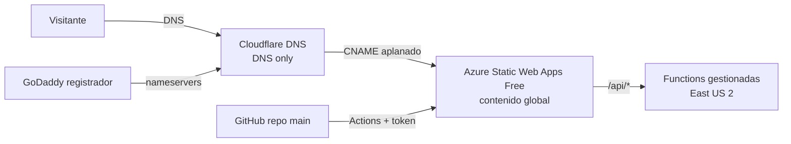

# Diseño: migración de almartin.ch a Azure Static Web Apps

- **Requisitos:** [requirements.md](./requirements.md)
- **Tareas:** [tasks.md](./tasks.md)

## Resumen

El repo sigue igual en contenido. Se añaden un workflow de GitHub Actions, un `staticwebapp.config.json` y una carpeta `api/`. Azure Static Web Apps (Free, East US 2) sirve el sitio y la API; Cloudflare responde los DNS; GoDaddy solo queda como registrador.

## Arquitectura

| Pieza | Hoy | Destino |
| --- | --- | --- |
| Hosting | GitHub Pages | Azure Static Web Apps Free |
| Registrador | GoDaddy | GoDaddy (sin cambios) |
| DNS | GoDaddy | Cloudflare Free |
| Despliegue | Push a `main` | GitHub Actions con token de despliegue |
| API | Ninguna | Functions gestionadas en `/api` |
| Repo | Público | Privado (al final) |

## Decisiones

### D1. Crear la Static Web App sin `--source`

Si se crea con `--source`, Azure commitea su propio workflow en `main`. Para respetar el flujo de revisión, se crea sin enlazar y se usa un token de despliegue guardado como secreto `AZURE_STATIC_WEB_APPS_API_TOKEN`. El workflow lo escribimos nosotros. Los PRs contra `main` generan vistas previas; al fusionar el PR se despliega a producción.

### D2. Cloudflare en modo DNS only

Con el proxy activo, Azure no puede validar el dominio ni emitir el certificado, y habría dos CDN en cadena. Cloudflare se usa solo por el CNAME flattening, que permite apuntar el dominio raíz a un hostname de Azure. GoDaddy no lo ofrece.

### D3. Validación TXT antes del cambio de tráfico

El dominio raíz se registra en Azure con `dns-txt-token`. El TXT se crea mientras los registros A siguen apuntando a GitHub Pages. Solo cuando el dominio está en estado Ready (certificado emitido) se sustituyen los A por el CNAME. Así no hay ventana sin HTTPS.

### D4. `almartin.ch` como dominio predeterminado

Los 2 dominios del plan Free se usan para `almartin.ch` y `www.almartin.ch`. El raíz se marca como predeterminado en el portal y Azure redirige `www` hacia él.

### D5. Región East US 2

West Europe, la región de Static Web Apps más cercana a Suiza, no acepta clientes nuevos (2026-11-04: `RequestDisallowedByAzure`). Se usa East US 2, la más cercana a Europa de las disponibles. Afecta solo a la API y a la gestión: el contenido estático se sirve desde ubicaciones globales. Cada llamada a `/api` suma unos 100 ms desde Suiza. El grupo `rg-almartin` sigue en West Europe (un grupo puede contener recursos de otras regiones). Reconsiderar si West Europe vuelve a aceptar clientes.

### D6. Cloudflare con la CLI `cf`

Los registros DNS se gestionan con `cf` (npm, beta), la CLI oficial que ya está autenticada en el equipo de Martin. Cada creación se prueba antes con `--dry-run`. Los borrados piden confirmación.

### D7. Sin build

El sitio es HTML estático. El workflow usa `skip_app_build: true` y `app_location: "/"`.

## Componentes

### Workflow `.github/workflows/azure-static-web-apps.yml`

- Disparadores: `push` a `main`; `pull_request` (opened, synchronize, reopened, closed) contra `main`.
- Job `build_and_deploy` con `Azure/static-web-apps-deploy@v1`, `action: upload`, `app_location: "/"`, `api_location: "api"`, `output_location: ""`, `skip_app_build: true`.
- Job `close_pull_request` con `action: close` cuando se cierra el PR.

### `staticwebapp.config.json`

- `responseOverrides.404` → `/404.html` (archivo nuevo, sencillo, con el mismo estilo del sitio).
- `globalHeaders`: CSP compatible con lo que carga hoy `index.html`, HSTS (`max-age=31536000`), `X-Content-Type-Options: nosniff`, `Referrer-Policy: strict-origin-when-cross-origin`.
- `routes`: `Cache-Control: no-cache` para `/service-worker.js` y `/manifest.json`; caché larga para `/css/*`, `/favicon_io/*`.
- La CSP se deriva de los recursos que carga el sitio actual; se revisa en la vista previa antes de fusionar.

### `api/`

- Function HTTP en Node.js (modelo de programación v4): `api/src/functions/hello.js`, `GET /api/hello` → `{ "message": "hola desde Azure" }`.
- `api/package.json` con `@azure/functions` y `api/host.json`.

### Exclusiones de despliegue

- `.claude/` y `screenshots/` no hacen falta en producción; se excluyen si el tamaño se acerca al límite de 250 MB (hoy no).

## Plan de DNS

| Registro | Antes | Después |
| --- | --- | --- |
| `@` A ×4 | 185.199.108.153 – 185.199.111.153 (GitHub Pages) | Eliminados |
| `@` CNAME | — | `xxx.azurestaticapps.net` (aplanado) |
| `@` TXT | — | token de validación de Azure |
| `www` CNAME | `almartinch.github.io` (a confirmar) | `xxx.azurestaticapps.net` |
| Otros registros | GoDaddy | Copiados tal cual (no hay correo) |

## Riesgos y vuelta atrás

| Riesgo | Señal | Vuelta atrás |
| --- | --- | --- |
| Falta algún registro al cambiar nameservers | Un subdominio deja de resolver | Añadirlo en Cloudflare o volver a los nameservers de GoDaddy |
| DNSSEC activo al cambiar nameservers | El dominio no resuelve | Quitar el DS en GoDaddy |
| El sitio en Azure falla tras el cambio | Errores en `almartin.ch` | Restaurar los 4 A de GitHub Pages en Cloudflare |
| Certificado no emitido | Aviso HTTPS | No mover el raíz hasta estado Ready |
| CSP bloquea recursos | Consola del navegador con errores CSP | Ajustar la CSP en la vista previa antes de fusionar |
| Más de 100 GB al mes | Azure deja de servir hasta el mes siguiente | Pasar a Standard (unos 9 USD al mes) |

## Fuentes

- [Planes de Static Web Apps](https://learn.microsoft.com/en-us/azure/static-web-apps/plans)
- [Cuotas de Static Web Apps](https://learn.microsoft.com/en-us/azure/static-web-apps/quotas)
- [Retiro de Azure CDN clásico](https://learn.microsoft.com/azure/cdn/classic-cdn-retirement-faq)
- [Precios de Azure Front Door](https://azure.microsoft.com/pricing/details/frontdoor/)
